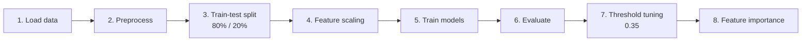

<div align="center">


**Predicting who will leave, and understanding the trade-off between catching churners and raising false alarms.**

</div>

---

## 📑 Table of Contents

[Overview](#-overview) · [Objectives](#-objectives) · [Tech Stack](#-tech-stack) · [Workflow](#-project-workflow) · [Models](#-models-implemented) · [Results](#-results) · [Feature Importance](#-feature-importance) · [Imbalance & Thresholds](#-handling-class-imbalance-and-threshold-tuning) · [Structure](#-project-structure) · [Usage](#-installation-and-usage) · [Learnings](#-key-learnings) · [Limitations](#-limitations-and-future-improvements) · [Disclaimer](#-disclaimer) · [Author](#-author)

---

## 📌 Overview

This project uses machine learning to predict customer churn from customer-related attributes. It compares **Logistic Regression**, **Random Forest**, and **Gradient Boosting**, with a focus on evaluating churn detection and exploring how classification thresholds affect precision and recall.

The project uses a **synthetic dataset containing 100,000 customer records** and implements a modular workflow for preprocessing, model training, evaluation, threshold tuning, and feature importance analysis.

<div align="center">

| 🗂️ Dataset | 🧪 Test set | 🤖 Models | 🎚️ Custom threshold |
|:---:|:---:|:---:|:---:|
| **100,000** synthetic records | **20,000** held-out records | **3** classifiers | **0.35** |

</div>

---

## 🎯 Objectives

- ✅ Develop a customer churn classification pipeline using Python and scikit-learn.
- ✅ Compare multiple machine learning classification algorithms.
- ✅ Explore class imbalance handling using class weights.
- ✅ Investigate the precision–recall trade-off through probability-threshold tuning.
- ✅ Identify influential features using Gradient Boosting feature importance.

---

## 🧰 Tech Stack

| Category | Tools |
|---|---|
| **Language** |  |
| **Data processing** |   |
| **Machine learning** |  |
| **Development tools** |     |

---

## 🔄 Project Workflow



| Step | Stage | Description |
|:---:|---|---|
| **1** | 📥 **Data loading** | Load the synthetic customer churn dataset. |
| **2** | 🧹 **Preprocessing** | Remove the customer identifier, separate features and target labels, and encode categorical features using one-hot encoding. |
| **3** | ✂️ **Train-test split** | Split the dataset into 80% training data and 20% test data. |
| **4** | 📏 **Feature scaling** | Standardize features for Logistic Regression. Random Forest and Gradient Boosting use the encoded, unscaled features. |
| **5** | 🏋️ **Model training** | Train Logistic Regression, Random Forest, and Gradient Boosting classifiers. |
| **6** | 📊 **Model evaluation** | Compare precision, recall, F1-score, and accuracy using classification reports. |
| **7** | 🎚️ **Threshold tuning** | Evaluate Gradient Boosting with a custom probability threshold of `0.35`. |
| **8** | 🔎 **Feature importance** | Identify the features with the highest importance scores in the Gradient Boosting model. |

---

## 🤖 Models Implemented

| Model | Configuration |
|---|---|
| 📈 **Logistic Regression** | Trained using standardized features |
| 🌲 **Random Forest** | Uses `class_weight='balanced'` |
| 🚀 **Gradient Boosting** | Evaluated with the default threshold and a custom threshold of `0.35` |

---

## 🏆 Results

The following results were obtained by running `python main.py` on a held-out test set of **20,000 records**.

### Default model comparison

| Model | Accuracy | Churn Precision | Churn Recall | Churn F1-score |
|---|---:|---:|---:|---:|
| Logistic Regression | 0.72 | 0.62 | 0.46 | 0.53 |
| Random Forest | 0.71 | 0.56 | **0.62** | 0.59 |
| Gradient Boosting | **0.76** | **0.67** | 0.56 | **0.61** |

*Churn metrics refer to class `1` in the classification report.*

### Gradient Boosting: threshold comparison

| Metric | Default threshold | Threshold = 0.35 | Change |
|---|---:|---:|:---:|
| Accuracy | 0.76 | 0.75 | 🔻 |
| Churn precision | 0.67 | 0.64 | 🔻 |
| Churn recall | 0.56 | 0.60 | 🔺 |
| Churn F1-score | 0.61 | 0.62 | 🔺 |

### 💡 Key findings

- 🥇 Gradient Boosting achieved the highest default accuracy among the three models, at **0.76**.
- 🎚️ Lowering the Gradient Boosting classification threshold from the default `0.5` to `0.35` increased churn recall from **0.56 to 0.60**.
- ⚖️ Churn precision decreased from `0.67` to `0.64`, illustrating the trade-off between identifying more potential churners and generating more false-positive predictions.
- 📉 The churn F1-score increased from `0.61` to `0.62`, while accuracy decreased from `0.76` to `0.75`.
- 🌲 Random Forest achieved a churn recall of `0.62` using balanced class weights, but its overall accuracy was `0.71`.

> [!IMPORTANT]
> These results illustrate why model selection should consider the business objective and the cost of missed churners versus unnecessary retention interventions, rather than accuracy alone.

---

## 🔎 Feature Importance

The Gradient Boosting model identified the following top features:

| Rank | Feature | Importance | |
|:---:|---|---:|---|
| 1 | `MonthlyCharges` | 0.3269 | ██████████████████████████████ |
| 2 | `Tenure` | 0.3228 | █████████████████████████████░ |
| 3 | `Contract_One year` | 0.2024 | ██████████████████░░░░░░░░░░░░ |
| 4 | `Contract_Two year` | 0.1393 | ████████████░░░░░░░░░░░░░░░░░░ |
| 5 | `TotalCharges` | 0.0062 | ░░░░░░░░░░░░░░░░░░░░░░░░░░░░░░ |

The remaining features had substantially smaller importance scores in this model.

> [!NOTE]
> These scores describe the model's relative reliance on features; they do not establish that a feature causes customer churn.

---

## ⚖️ Handling Class Imbalance and Threshold Tuning

The project explores two approaches:

- 🏷️ **Class weighting:** Random Forest uses `class_weight='balanced'` to account for class frequencies during training.
- 🎚️ **Probability-threshold adjustment:** Gradient Boosting uses a threshold of `0.35` to classify customers as churners when their predicted churn probability exceeds that value.

> [!NOTE]
> The approaches are implemented on different models. The observed recall changes from `0.56` to `0.60` are specifically associated with threshold tuning of Gradient Boosting, not with applying class weighting to that same model.

---

## 🗂️ Project Structure

```text
Customer-Churn-Prediction/
├── Data/
│   └── synthetic_customer_churn_100k.csv
├── src/
│   ├── preprocess.py
│   ├── train.py
│   └── evaluate.py
├── main.py
├── requirements.txt
└── README.md
```

---

## ⚙️ Installation and Usage

### 1️⃣ Clone the repository

```bash
git clone https://github.com/muneer-ahmad10/Customer-Churn-Prediction.git
cd Customer-Churn-Prediction
```

### 2️⃣ Create and activate a virtual environment

```bash
python3 -m venv venv
source venv/bin/activate
```

On Windows, activate the environment using:

```bash
venv\Scripts\activate
```

### 3️⃣ Install dependencies

```bash
pip install pandas numpy scikit-learn
```

Alternatively, install the dependencies listed in the project file:

```bash
pip install -r requirements.txt
```

### 4️⃣ Verify the dataset path

The dataset is stored under `Data/` in the repository. Ensure that the path used in `main.py` matches the actual folder name, including capitalization:

```python
X, y = load_and_preprocess(
    "Data/synthetic_customer_churn_100k.csv"
)
```

### 5️⃣ Run the pipeline

```bash
python main.py
```

The script trains the models, prints classification reports, evaluates Gradient Boosting at the custom threshold, and displays the top features by importance.

---

## 🧠 Key Learnings

- 🔧 Building a modular machine learning pipeline.
- ⚔️ Comparing linear and ensemble classification models.
- 📐 Understanding precision, recall, F1-score, and accuracy.
- 🎚️ Exploring class weighting and threshold adjustments for churn detection.
- 🔍 Interpreting feature importance and the limitations of model-based explanations.
- 🎯 Evaluating model performance beyond accuracy alone.

---

## 🚧 Limitations and Future Improvements

- [ ] The dataset is synthetic, so results may not generalize to real customer behavior.
- [ ] Select the classification threshold using validation data, then evaluate the final model on an untouched test set.
- [ ] Add confusion matrices and ROC-AUC or precision–recall curves for a broader evaluation.
- [ ] Explore cross-validation and hyperparameter tuning.
- [ ] Investigate explainability techniques such as SHAP.
- [ ] Validate the workflow on a real-world customer churn dataset.

---

## ⚠️ Disclaimer

> [!WARNING]
> This project is intended for educational purposes and experimentation with machine learning. The dataset is synthetic, and the reported results should not be interpreted as evidence of performance on real customer populations.

---

## 👤 Author

<div align="center">

**Muneer Ahmad Dar**

[](https://github.com/muneer-ahmad10)
[](https://www.linkedin.com/in/muneerah-826363267/)


</div>
